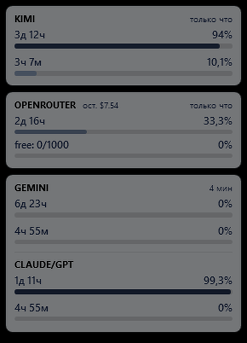
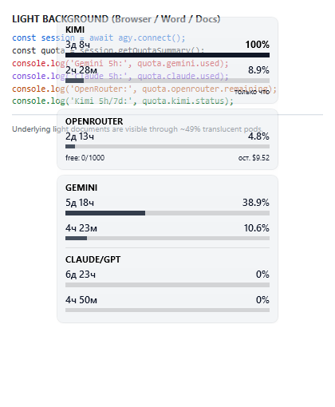

# LLM Limits Overlay

**English** | [Русский](README.ru.md)

**LLM Limits Overlay** is a compact Always-on-Top HUD overlay for Windows 10/11 featuring lightweight translucency (~49%), monochrome consumption gauges, and sharp ClearType typography. It provides real-time visibility into usage quotas and reset limits for popular AI models: **Gemini**, **Claude / GPT**, **Kimi**, and **OpenRouter** in a single minimalist floating window.

---

## Screenshots

| Dark Background (IDE / Terminal) | Light Background (Browser / Documents) |
| :---: | :---: |
|  |  |

*(Background text and underlying windows show through the matte translucent cards, while percentages and timers remain sharp and high-contrast)*

---

## Features

- **Always-on-Top HUD**: Floats seamlessly above all windows in the bottom-right corner of the screen above the taskbar.
- **Dynamic Height Auto-Sizing (`SizeToContent="Height"`)**: Automatically conforms to content height so card shadows and rounded bottom corners are never clipped.
- **Zero Desktop Clutter**:
  - `ShowInTaskbar="False"`: Does not take up space on the Windows taskbar.
  - `WS_EX_TOOLWINDOW`: Excluded from the `Alt-Tab` application switcher.
  - Native Win32 GUI subsystem (`/target:winexe`): Launches silently without flashing CMD/PowerShell console windows or helper launchers.
- **Monochrome Visual Indicators**: A unified graphite scale that gradually darkens as quota is consumed (from neutral gray to deep black), avoiding distracting traffic-light colors.
- **Free Dragging & System Tray Control**:
  - Left-click and drag: Move the HUD to any preferred position on the screen.
  - Right-click: Context menu for manual quota refresh and exiting.
  - Windows System Tray icon: Single-click show/hide, comprehensive control menu, position reset, and tooltip with live percentages.
- **Fast Native Polling (v1.2.0+, no Python / WSL required)**:
  - All quota fetches run **in-process** as concurrent async tasks — no subprocess spawning, no `wsl.exe`, no Python.
  - Per-provider timeouts: HTTP 3.5 s for OpenRouter / Kimi; 8 s for `agy.exe`.
  - Antigravity quota caching (300 s in `%TEMP%\llm_limits_agy_usage_cache.json`) keeps the `agy.exe` call rate minimal while OpenRouter and Kimi are refreshed on every 60-second polling cycle.
- **Per-Card Update Timestamps (v1.2.0+)**:
  - Each of the three cards (KIMI / OPENROUTER / GEMINI+CLAUDE-GPT) shows its own relative update age (`только что`, `N мин`) in the bottom-right corner.
  - Providers update independently, so the ages can differ across cards; a failed provider keeps the time of its **last successful fetch** and gets a ` (stale)` suffix on its own card only.

---

## Quota Metrics Displayed

The overlay presents information in three logical vertical cards from top to bottom:

1. **KIMI** (Top card):
   - **Weekly Limit (7d)**: Time until quota reset (e.g., `3d 8h`), percentage consumed (`100%`), and visual progress gauge.
   - **5-Hour Limit (5h)**: Time until reset (`2h 41m`), percentage consumed (`8.9%`), and progress bar.
   - Source: `GET https://api.kimi.com/coding/v1/usages` (HTTP Bearer auth).

2. **OPENROUTER** (Middle card):
   - **Key / Account Limit**: Time until calculated reset (`2d 13h`), percentage consumed (`3.7%`), and progress gauge.
   - **Secondary Status Line**: Free tier daily requests used (`free: 0/1000`) and remaining credit balance (`rem. $9.63`).
   - Source: `GET https://openrouter.ai/api/v1/key` (HTTP Bearer auth).

3. **GEMINI + CLAUDE / GPT** (Bottom combined card):
   - Grouped into a single card separated by a subtle divider:
     - **GEMINI**: Weekly rolling window (7d, top) and 5-hour rolling window (5h, bottom).
     - **CLAUDE / GPT**: Weekly rolling window (7d, top) and 5-hour rolling window (5h, bottom).
   - Source: Native `agy.exe -p /usage --output-format json` (Antigravity CLI v1.4.9+).

Each card shows its own **relative update time** in the bottom-right corner (`только что` = "just now", `N мин` = "N min ago"), recalculated every 10 seconds by the UI timer — no network requests. If a provider's block is `stale`, only its card gets the ` (stale)` suffix; the timestamp keeps showing the **last successful fetch** time and continues to age, so you can see how old the cached data really is. If a provider's API key is missing or is a placeholder (e.g. from `.env.example`), the card shows **нет ключа** instead of a time, and no HTTP request is made for that provider. The wording/format of these lines is defined by constants in `OverlayTheme.cs` (`RelativeTimeJustNow`, `RelativeTimeStaleSuffix`, `RelativeTimeNoKey`, etc.).

---

## System Requirements

- **OS**: Windows 10 or Windows 11 (64-bit) with .NET Framework 4.8 (included out of the box in Windows).
- **Antigravity CLI**: `agy.exe` (v1.4.9+) installed and signed in (`agy auth login`). Resolved automatically from `PATH` or `%LOCALAPPDATA%\agy\bin\agy.exe`.
- **No Python. No WSL.** Starting from v1.2.0 the overlay is fully self-contained.

---

## Architecture (v1.2.0+)

### In-Process Fetch

Since v1.2.0, quota fetching runs **entirely inside `LlmLimitsOverlay.exe`** with no external processes or scripts:

| Provider | Transport | Timeout | Auth |
|---|---|---|---|
| OpenRouter | `HttpWebRequest GET https://openrouter.ai/api/v1/key` | 3.5 s | Bearer `OPENROUTER_API_KEY` from `.env` |
| Kimi | `HttpWebRequest GET https://api.kimi.com/coding/v1/usages` | 3.5 s | Bearer `KIMI_API_KEY` from `.env` |
| AGY (Gemini/Claude) | `Process.Start(agy.exe -p /usage --output-format json)` | 8 s | OAuth token pre-checked at `%USERPROFILE%\.gemini\antigravity-cli\antigravity-oauth-token` |

All three providers run in parallel via `Task.Run`. Each atomically writes its fragment (`limits.agy.json`, `limits.openrouter.json`, `limits.kimi.json`) as soon as it finishes, then a merge step assembles the final `limits.json`. If one provider fails or times out, its block is marked `stale` while the others remain `online`.

### OAuth Anti-Popup Guard

Before spawning `agy.exe`, the overlay checks that `%USERPROFILE%\.gemini\antigravity-cli\antigravity-oauth-token` exists and is non-empty. If the token is missing, `agy.exe` is skipped entirely (returning `stale`) — preventing an unwanted browser OAuth popup.

### AGY Cache

The raw `agy.exe` JSON response is cached for 300 seconds in `%TEMP%\llm_limits_agy_usage_cache.json`. Within the TTL, `agy.exe` is never re-spawned; the cache is shared across process restarts.

### Error Isolation

If `agy.exe` hangs or is not found → only the Gemini/Claude card shows `stale`; OpenRouter and Kimi continue updating normally. The overall status in `limits.json` stays `online` as long as at least one provider is `online`.

### `limits.json` Format

Since commit `4f7df9a` (per-card update timestamps) every provider block carries its **own** `last_updated` — the time of that provider's last successful fetch (`yyyy-MM-dd HH:mm:ss`, local time). The root object:

```json
{
  "status": "online",
  "last_updated": "2026-10-28 16:38:27",
  "data": {
    "agy": {
      "status": "online",
      "last_updated": "2026-10-28 16:38:27",
      "gemini_5h":     { "percent": 88.0, "fraction": 0.8802, "used_percent": 12.0, "used_fraction": 0.1198, "reset_in": "2h 40m", ... },
      "gemini_weekly": { ... },
      "claude_5h":     { ... },
      "claude_weekly": { ... }
    },
    "openrouter": { "status": "online", "last_updated": "2026-10-28 16:38:27", "limit": 10.0, "usage": 1.36, "limit_remaining": 9.51, ... },
    "kimi": {
      "status": "online",
      "last_updated": "2026-10-28 16:38:27",
      "limit_5h": { "used_ratio": 0.39, "used_percent": 39.3, "reset_in": "1h 43m", ... },
      "limit_7d": { ... }
    }
  }
}
```

> Backward compatibility: readers written for the older flat layout (`data.gemini_5h`, `data.gemini_weekly`, `data.claude_5h`, `data.claude_weekly` at the root of `data`) are still supported — if `data.agy` buckets are absent, the flat keys are read as a fallback.

Timestamp semantics:

- `data.agy` is a metadata block for the whole Gemini+Claude/GPT card (the bucket values themselves remain in `gemini_5h`, `gemini_weekly`, `claude_5h`, `claude_weekly`).
- On failure or timeout a provider block becomes `stale`, and its `last_updated` is **preserved from the last success** — it keeps aging so the UI shows the real age of the displayed data.
- An AGY cache hit does **not** move the timestamp: it is taken from the cache record, so the card reflects the age of the cached data (up to 300 s).
- The root `last_updated` is the time of the last merge of all three providers; the root `status` stays `online` as long as at least one provider is `online`.
- If a per-provider `last_updated` is absent (files written by an older version), the reader falls back to the root `last_updated`.

---

## System Tray Icon

The application includes an icon in the Windows Notification Area (System Tray), providing complete control over the HUD even when the window is hidden or covered by full-screen applications.

### Tray Icon Interactions
- **Single or Double Left-Click**: Instantly toggles HUD visibility (window coordinates are fully preserved across hide/show cycles).
- **Tooltip**: Hovering over the icon displays a compact one-line status summary (e.g., `Kimi 7d 100% · Gemini 47% · Claude 50% [click-through]`), updated on every polling tick.

### Tray Context Menu (Right-Click)
- **Show Overlay / Hide Overlay** — Toggles window visibility while maintaining coordinates.
- *Separator*
- **Refresh Quotas** — Forces an immediate API query (disabled while a query is in progress).
- **Click-Through** — Toggles mouse click-through transparency mode.
- *Separator*
- **Reset Position** — Restores the HUD to its default docking spot in the bottom-right corner above the taskbar.
- **Exit** — Safely unregisters global hotkeys, cleans up the tray icon, closes the window, and terminates the background process.

> [!NOTE]
> **Windows 11**: By default, Windows 11 places new tray icons inside the overflow menu (the `^` arrow button). To keep the overlay icon always visible:
> Navigate to **Settings → Personalization → Taskbar → Other system tray icons** and enable the toggle for the overlay, or simply drag the icon from the `^` flyout directly onto the primary taskbar.

---

## Click-Through Mode

The overlay features a dedicated **click-through mode**, which is **enabled by default**.

In this mode:
- The window is completely transparent to mouse events at the Win32 subsystem level (`WS_EX_TRANSPARENT`).
- All mouse actions — left and right clicks, double-clicks, scroll wheel movements, and hovering — pass directly through to windows and UI elements positioned underneath the overlay.
- The overlay window **cannot be dragged with the mouse**, and **right-clicking it does not open the context menu**.
- The HUD remains visually pinned on top of all windows without impeding desktop interaction. The default position sits above the taskbar in the bottom-right corner, and can be repositioned via the tray menu's **Reset Position**.

### How to Toggle or Disable Click-Through
When interactive manipulation is needed (to reposition the window or open its context menu), click-through can be temporarily or permanently disabled:
1. **Global Keyboard Shortcut**: Press **`Ctrl+Alt+L`** (works globally from any application). The first keypress disables click-through and restores mouse interactivity; pressing it again re-enables click-through.
2. **System Tray Context Menu**: Right-click the system tray icon → select **Click-Through** (uncheck).
3. **Configuration File**: Set `"clickThrough": false` in `overlay.config.json` to start in standard interactive mode.

Each state change displays an informative balloon tip in the system tray, and the tooltip reflects the active mode with a `[click-through]` tag. The preference is automatically saved to `overlay.config.json` and restored on subsequent launches.

> [!WARNING]
> **Click-Through Mode Limitation**: While click-through is enabled, mouse clicks directly on the overlay window are ignored by design.
> **The system tray icon and the global hotkey (`Ctrl+Alt+L`) are the only ways to restore interactive mouse control.**

---

## Configuration

### File: `overlay.config.json`

The configuration file is automatically created next to the executable if not present:

```json
{
  "backend": "native",
  "timeoutSeconds": 0,
  "testHooks": false,
  "clickThrough": true,
  "clickThroughHotkey": "Ctrl+Alt+L"
}
```

- `backend`: Always `"native"` since v1.2.0 (Python/WSL removed). Legacy values `auto`/`windows`/`wsl` are silently normalized.
- `timeoutSeconds`: Overall fetch budget in seconds (0 = default 10 s).
- `testHooks`: Enables programmatic control via `.tray-action` file (default `false`).
- `clickThrough`: Startup click-through state (default `true`). Set to `false` for standard interactive mode.
- `clickThroughHotkey`: Global shortcut for toggling click-through (default `"Ctrl+Alt+L"`).

### Environment Variables

- `LLM_LIMITS_AGY_BIN`: Explicit path to `agy.exe`.
- `LLM_LIMITS_QUOTA_CACHE_SECONDS`: Cache duration for Antigravity quota calls (default `300`).
- `LLM_LIMITS_JSON` / `AGY_LIMITS_JSON`: Output path for the cached quota JSON file.

---

## API Key Setup

To display OpenRouter and Kimi quota metrics, the overlay requires valid API keys.

### Key Loading Order
API keys are read from the `.env` file located **next to `LlmLimitsOverlay.exe`** (highest priority), with fallback to process environment variables.

> [!IMPORTANT]
> Keys are **never** written to `overlay.log`, `limits.json`, or any cache file.
> OpenRouter returns the key itself in the `label` field when it has no name — the overlay detects key-looking values and stores a masked form (`sk-or-...XXXX`) instead, so raw keys never reach the disk.

### Example `.env` File
A template is provided in the repository as [.env.example](.env.example):

```env
# LLM Limits Overlay - API Key Configuration
OPENROUTER_API_KEY=sk-or-v1-xxxxxxxxxxxxxxxxxxxx
KIMI_API_KEY=sk-xxxxxxxxxxxxxxxxxxxxxxxxxxxx
```

The built-in C# parser supports:
- UTF-8 with or without BOM;
- Both CRLF (Windows) and LF (Linux) line endings;
- Blank lines and comments starting with `#`;
- Optional `export ` prefix;
- Whitespace around `=` (`KEY = value`);
- Single and double quotes around values (`'...'` / `"..."`);
- Trailing inline comments after unquoted values (`KEY=value # comment`);
- Safe skipping of malformed lines without throwing exceptions.

*(Keys are never printed to terminal/stdout/stderr, never displayed in the UI, never written to `overlay.log`, and never stored in `limits.json` cache files)*.

---

## Installation & Running

The primary and only method for running the overlay is the compiled executable **`LlmLimitsOverlay.exe`**.

> [!NOTE]
> **The PowerShell version has been removed from master; it remains accessible in tag and release [v1.0.0](https://github.com/Kzamirtay/llm-limits-overlay/releases/tag/v1.0.0).** Starting with version v1.1.0, the project runs exclusively as a standalone native C# application (.NET Framework 4.8 / WPF). Since v1.2.0, Python and WSL are no longer required.

### Runtime Directory Requirements
The following files must be located in the same directory as `LlmLimitsOverlay.exe`:
- `assets/app.ico` — Application icon for the HUD and system tray;
- `overlay.config.json` — Configuration file (automatically generated if missing);
- `.env` — API key configuration file (`OPENROUTER_API_KEY`, `KIMI_API_KEY`).

### Launch Options

#### 1. Running the Prebuilt Binary from Releases
1. Download the latest `LlmLimitsOverlay-vX.Y.Z-win64.zip` from [Releases](https://github.com/Kzamirtay/llm-limits-overlay/releases).
2. Extract the archive into any preferred directory.
3. Create your `.env` file with your API keys (copy from `.env.example`).
4. Ensure `agy.exe` is installed and you are signed in (`agy auth login`).
5. Launch `LlmLimitsOverlay.exe` by double-clicking it in Windows Explorer or from the command line:
   ```cmd
   LlmLimitsOverlay.exe
   ```
   The application starts cleanly as a Windows GUI subsystem process (`/target:winexe`) without console flashes.

#### 2. Building from Source
If you cloned the repository and wish to compile the binary locally:
```cmd
dotnet\build.cmd
```
The build script automatically locates the system compiler `csc.exe` (`C:\Windows\Microsoft.NET\Framework64\v4.0.30319\csc.exe`), requires no Visual Studio, MSBuild, or .NET SDK installation, and produces an optimized standalone executable in:
```
dotnet\bin\LlmLimitsOverlay.exe
```
Technical architecture details are documented in [dotnet/README.md](dotnet/README.md).

#### 3. Windows Installer (v1.2.0+)
A per-user Windows installer is available: `LlmLimitsOverlay-Setup-1.3.1.exe` (Inno Setup 6).

**Features:**
- Installs to `%LOCALAPPDATA%\LlmLimitsOverlay` — no UAC elevation required.
- Creates Start Menu shortcut (always); optional Desktop shortcut and optional autostart (HKCU Run).
- Registers uninstall entry in "Apps & Features" / "Programs and Features".
- **Preserves your `.env` file** on upgrade and uninstall (`onlyifdoesntexist`, `uninsneveruninstall`).
- Closes any running overlay instance from the same install location before installing/updating.
- Data files (`limits*.json`, `overlay.log`) are removed on uninstall; `.env` is kept.

**Silent install (for automation):**
```cmd
LlmLimitsOverlay-Setup-1.3.1.exe /VERYSILENT /SUPPRESSMSGBOXES /NORESTART /LOG=%TEMP%\llmo-install.log
```
> [!NOTE]
> **SmartScreen warning**: The installer is not code-signed (no EV certificate). Windows SmartScreen will show "Windows protected your PC" — click "More info" → "Run anyway". This is expected for open-source projects without a paid certificate.

**Uninstall:** Use "Apps & Features" in Windows Settings, or run silently:
```cmd
"%LOCALAPPDATA%\LlmLimitsOverlay\unins000.exe" /VERYSILENT /SUPPRESSMSGBOXES /NORESTART
```

#### 4. CLI: `llm-limits.exe`
A companion console utility ships next to the GUI (same fetch engine, same timeouts, same cache). It prints quota status to the terminal for scripts and quick checks.

```cmd
llm-limits --json            # works from any folder — installer adds it to your user PATH
llm-limits --provider kimi
llm-limits --watch 30        # refresh loop; Ctrl+C to exit
llm-limits --no-cache        # bypass the agy /usage cache (forces agy.exe run)
llm-limits --env .env --agy-bin C:\tools\agy.exe
```

- The installer adds the install folder to your **user PATH** (task "Add llm-limits.exe to user PATH", enabled by default) so `llm-limits` runs from any terminal. Terminals opened **before** the installation won't see it — open a new terminal window. The entry is removed on uninstall.
- `--provider kimi|openrouter|agy`, `--env <path>`, `--config <path>`, `--agy-bin <path>` — overrides.
- `--agy-timeout <sec>` (1–120) — agy spawn timeout. Platform default: **Windows 8 s, Linux/macOS 20 s** (agy can be slow in WSL/FUSE environments). Can also be set with `LLM_LIMITS_AGY_TIMEOUT` (flag wins over env, env over platform default). The GUI keeps its own fixed 8 s timeout and cache rule.
- `--no-color` and the `NO_COLOR` environment variable disable ANSI colors.
- In `--watch` mode with redirected (non-TTY) output the tool prints one block per tick instead of redrawing the screen.
- Exit codes: `0` — all providers online; `2` — some providers stale or missing key (`no_key`); `1` — all failed or bad arguments.
- If a provider key is a placeholder (not set), its status is `no_key` — no HTTP request is made, and the card shows `нет ключа`. Fill in real keys in `.env` next to `LlmLimitsOverlay.exe`.
- API keys and raw OpenRouter labels are never printed (labels are masked, same as in `limits.json`).

#### 5. Linux CLI (`llm-limits-linux-x64`)
A self-contained Linux build of the same CLI ships in releases (`llm-limits-linux-x64`). It needs nothing installed — .NET runtime is bundled.

```bash
# copy to your user bin and make executable
mkdir -p ~/.local/bin
cp llm-limits-linux-x64 ~/.local/bin/llm-limits
chmod +x ~/.local/bin/llm-limits

llm-limits --json
llm-limits --watch 30
```

- Keys are read from `.env` **next to the binary** (or `--env <path>`).
- The Gemini/Claude card requires the native Linux `agy` binary: it is resolved from `LLM_LIMITS_AGY_BIN`, then `PATH`, then `~/.local/bin/agy`, `/usr/local/bin/agy`. The OAuth token is read from `~/.gemini/antigravity-cli/antigravity-oauth-token`.
- Everything else (Kimi, OpenRouter) works without `agy`.
- Build from source (requires .NET SDK 8):
  ```bash
  dotnet publish dotnet/LlmLimitsCli.Linux -c Release -r linux-x64 \
    --self-contained true -p:PublishSingleFile=true \
    -p:IncludeNativeLibrariesForSelfExtract=true -o dist/linux
  ```

---

## Diagnostics & Logs

Startup sequences, fetch results, cache hits, and errors are logged to `overlay.log` in the application directory:

```
[2026-10-28 15:30:00] === LLM Limits Overlay Starting (PID=12345) ===
[2026-10-28 15:30:00] Cache loaded successfully from ...\limits.json (status: online).
[2026-10-28 15:30:00] Starting async native refresh at 2026-10-28 15:30:00...
[2026-10-28 15:30:01] [cache] agy /usage cache hit (age 45.3s <= 300s), agy.exe not respawned
[2026-10-28 15:30:01] Native refresh finished (agy: online, openrouter: online, kimi: online -> root: online).
```

No `Spawned refresh process` or `exitCode` lines appear — fetching is in-process.

---

## Repository File Structure

```
llm-limits-overlay/
├── assets/
│   └── app.ico                  # Application icon (multi-resolution Win32 icon)
├── docs/
│   └── screenshots/
│       ├── dark.png             # Overlay on dark background
│       └── light.png            # Overlay on light background
├── dotnet/                      # C# source code (.NET Framework 4.8 / WPF)
│   ├── LlmLimitsOverlay/        # C# source files (.cs)
│   ├── build.cmd                # Standalone build script via csc.exe (no external SDK required)
│   └── README.md                # Architecture documentation
├── overlay.config.json          # Configuration file (auto-generated if missing)
├── .env.example                 # Template for API keys (OpenRouter, Kimi)
├── .gitignore                   # Git ignore patterns for caches, logs, and local state
├── LICENSE                      # MIT License
├── README.md                    # Project documentation (English)
└── README.ru.md                 # Project documentation (Russian)
```

---

## License

This project is licensed under the open-source [MIT License](LICENSE).
Copyright (c) 2026 Kzamirtay.
